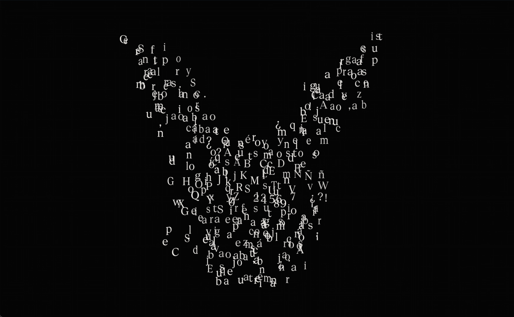

# Geist Serif — Anamorphosis

Hundreds of Geist Serif letters float in 3D space. From one exact point of view, they line up and form the Evil Rabbit mark: a rabbit made of readable text. Move away and it breaks into chaos again.

**Live:** https://franguzmanx.github.io/geist-serif-anamorphosis/

Demo video: [demo.mp4](demo.mp4)

## Controls

| Action | Mouse / trackpad | Touch |
| --- | --- | --- |
| Turn in any direction | Drag | Drag |
| Zoom into the cloud | Scroll or pinch | Pinch |
| Back to the rabbit | Double-click, Space or Enter | Double-tap |

If you leave it alone, the camera wanders into the cloud and back to the rabbit by itself.

## How it works

- Each letter is set on a line inside the rabbit silhouette, like a calligram.
- Each letter is then pushed to a random depth along the ray from the "solve" camera to its spot, and scaled by that depth. From that one camera the rabbit is exact, even while the letters drift.
- Off-axis, each letter also spins on itself. The spin fades to zero as you come back to the solve angle.
- One instanced mesh and one glyph atlas, rendered with [three.js](https://threejs.org).

It is one self-contained file: `index.html`. The font is embedded. three.js loads from a CDN, so you need a connection. To run it locally, open `index.html` in a browser.

## Credits

- Typeface: [Geist Serif](https://vercel.com/font) by Vercel with basement.studio, under the SIL Open Font License 1.1 (see `FONT-LICENSE.txt`).
- The rabbit mark belongs to its owner and is not covered by any open license here.
